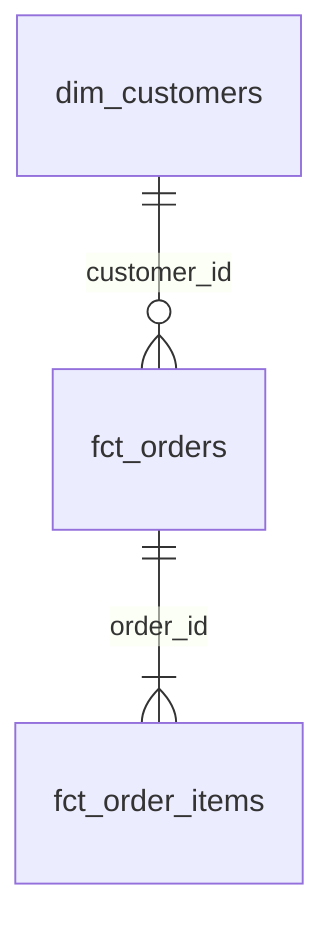

# Домашнее задание 5. Витрины интернет-магазина по схеме «звезда»

Это продолжение семинара и **первый слой сквозного проекта курса**. Дальше эти витрины переедут в Greenplum, их сборку будет запускать Airflow, а рядом появятся потоковые данные из Kafka и ClickHouse. Поэтому делайте проект так, как будто им будут пользоваться другие: понятные имена, тесты и описания.

## Задача

Вам дана сырая OLTP-база интернет-магазина. Её схема описана в `models/staging/shop/_shop__sources.yml`:

| Таблица | Одна строка — это | Ключ |
|---|---|---|
| `customers` | клиент | `customer_id` |
| `products` | товар; категория записана текстом | `product_id` |
| `product_categories` | категория; дерево до 3 уровней через `parent_category_id` | `category_id` |
| `orders` | заказ | `order_id` |
| `order_items` | товар в заказе | `(order_id, product_id)` |
| `payments` | платёжная операция: попытка, оплата частью, возврат | `payment_id` |

Нужно:

1. **Спроектировать** аналитические витрины по схеме «звезда».
2. **Реализовать** их в dbt со слоями staging / intermediate / marts.
3. **Написать тесты** на ключевые поля и на бизнес-логику.
4. **Собрать документацию** проекта.

Бизнес хочет отвечать на вопросы такого вида: выручка по месяцам и категориям товаров, доля покупателей по каналам привлечения, средний чек по городам, какие бренды чаще возвращают.

## Обязательные витрины

| Витрина | Тип | Зернистость (одна строка — это…) | Что должно быть |
|---|---|---|---|
| `fct_orders` | факт | заказ | Есть после семинара. Добавьте `items_count` — число разных товаров в заказе. Тестовых заказов нет |
| `fct_order_items` | факт | товар в заказе | Ключи на все измерения: `product_id`, `customer_id`, `order_date`; меры `quantity`, `unit_price`, `discount_amount`, `line_amount`; признак `is_confirmed` заказа |
| `dim_customers` | измерение | клиент, **включая не купивших** | Атрибуты клиента; первая подтверждённая покупка (`first_confirmed_order_id`, `first_confirmed_at`); `confirmed_orders_count`, `confirmed_revenue`, `is_buyer` |
| `dim_products` | измерение | товар | Название, бренд и иерархия: `category_name`, `parent_category_name`, `root_category_name` — верхний уровень (`Electronics` или `Home`) |
| `dim_dates` | измерение | день | Календарь, покрывающий все даты заказов: год, квартал, месяц, день недели, `is_weekend` |

Названия колонок, кроме перечисленных, выбирайте сами. Можно добавить свои витрины, если сможете объяснить, какой бизнес-вопрос они закрывают.

## Требования к слоям

| Слой | Схема в базе | Материализация | Правила |
|---|---|---|---|
| staging | `analytics_staging` | view | По одной модели на **каждую** таблицу источника, имена `stg_shop__<таблица>`. Без JOIN и агрегаций. Только здесь используется `source()` |
| intermediate | `analytics_intermediate` | view или ephemeral | JOIN, агрегации, сложная логика. Нужны минимум `int_orders_with_payments` и модель, которая разворачивает дерево категорий |
| marts | `analytics_marts` | table | Только `fct_` и `dim_`. Читают только `ref()` |

Подсказка про дерево категорий: глубина сейчас равна 3 (`Home > Kitchen > Cookware`). Решение с рекурсивным CTE (`with recursive`) не сломается, если появится четвёртый уровень.

## Требования к тестам

**Generic-тесты:**

- `unique` и `not_null` на первичный ключ **каждой** модели staging и marts;
- `relationships` от каждого внешнего ключа фактов к своему измерению: `fct_order_items.product_id → dim_products`, `… customer_id → dim_customers`, `… order_date → dim_dates`, `fct_orders.customer_id → dim_customers`;
- `accepted_values` на статусы заказа и платежа;
- **свой generic-тест** в `tests/generic/` (например, `non_negative`: значение не меньше нуля), применённый минимум к двум колонкам.

**Singular-тесты на бизнес-логику, минимум 4:**

1. Сумма заказа в `fct_orders` равна сумме `line_amount` его позиций в `fct_order_items`.
2. Сверка с источником: сумма подтверждённых покупок в витрине совпадает с суммой, посчитанной прямо по `source('shop', 'orders')` и `source('shop', 'payments')`.
3. По возвращённому заказу деньги вернулись полностью: `net_paid_amount = 0`.
4. Подтверждённому заказу не списали больше его суммы. Этот тест **найдёт** реальную проблему. Не подгоняйте под него данные: поставьте `severity: warn` и опишите в документации, что найдено.

Можно добавить свои проверки, например: первая покупка не раньше регистрации.

## Требования к документации

- `description` у каждой модели marts и у **каждой** их колонки; у staging — у моделей и ключевых колонок.
- Определение подтверждённой покупки — в **doc-блоке** (`` в файле `models/docs.md`). Используйте его в описаниях `is_confirmed` через `{{ doc("confirmed_order") }}`.
- Страница обзора проекта: doc-блок `__overview__`.
- В `README.md` вашего репозитория добавьте раздел «Модель данных»:
  - ER-диаграмму звезды: Mermaid `erDiagram` (GitHub рисует его сам) или картинку;
  - для каждой витрины одну строку: зернистость и на какой бизнес-вопрос она отвечает;
  - скриншот графа lineage из `dbt docs serve` (файл `docs/lineage.png`).

Каркас для Mermaid:

````markdown

````

## Бонус (+1 балл, не обязательно)

Одно на выбор:

- сделать `fct_order_items` инкрементальной моделью (`materialized='incremental'`, `unique_key`, `is_incremental()`). В README объясните, какие изменения в источнике такая модель **пропустит**;
- подключить пакет `dbt_utils` (`packages.yml`, `dbt deps`) и использовать его для календаря (`date_spine`) или ключа (`generate_surrogate_key`).

## Как сдавать

1. Создайте **свой** пустой репозиторий на GitHub или GitLab, приватный или публичный, и дайте доступ преподавателю.
2. Привяжите к нему локальный проект, склонированный на семинаре, и отправьте код:

   ```bash
   git remote rename origin course              # исходный репозиторий курса
   git remote add origin <ссылка на ваш репозиторий>
   git push -u origin main
   ```

3. Пришлите ссылку на репозиторий.

Перед отправкой проверьте с нуля так же, как будет проверять преподаватель:

```bash
docker compose down -v && docker compose up -d postgres
docker compose run --rm dbt build      # ожидается ERROR=0; WARN допустим, если объяснён
```

Папки `target/`, `logs/`, `dbt_packages/` в репозиторий не кладите: они уже в `.gitignore`.

## Критерии оценки (10 баллов)

| Критерий | Баллы |
|---|---|
| `dbt build` с нуля проходит без ошибок | 1 |
| Staging: модель на каждую таблицу, без JOIN и агрегаций, только `source()` | 1 |
| Intermediate: платежи свёрнуты до заказа, дерево категорий развёрнуто | 1,5 |
| Marts: 5 витрин с заявленной зернистостью, цифры сходятся с самопроверкой | 2,5 |
| Generic-тесты, включая свой generic-тест | 1,5 |
| Singular-тесты на бизнес-логику (минимум 4) | 1,5 |
| Документация: описания, doc-блок, overview, ER-диаграмма, lineage | 1 |
| Бонус | +1 |

## Самопроверка

| Проверка | Ожидаемый результат |
|---|---|
| `fct_orders` | `135` строк, тестовых заказов нет |
| Подтверждённые заказы / сумма | `106` / `91 620,00` |
| `fct_order_items` | `425` строк (из `444` позиций исключены позиции тестовых заказов) |
| Сумма `line_amount` по подтверждённым заказам | `91 620,00` — совпадает с `fct_orders` |
| `dim_customers` | `40` строк: `29` покупателей, `11` без покупок |
| Клиент `1` | Первая подтверждённая покупка — заказ `101`, всего `9` покупок на `7 280,00` |
| Клиент `40` | `is_buyer = false`, первая покупка — `null` |
| `dim_products` | `13` строк. Товар `11` (`Pot A`): `Home > Kitchen > Cookware`; товар `12` (`Case B`): `Electronics > Accessories > Cases` |
| Выручка подтверждённых заказов по `root_category_name` | `Electronics` — `59 994,28`, `Home` — `31 625,72` |
| `dim_dates` | `133` дня: с `2026-03-01` по `2026-07-11` |
| Тест «не списали больше суммы заказа» | `WARN`: заказ `113`, двойное списание `2 × 200` |
